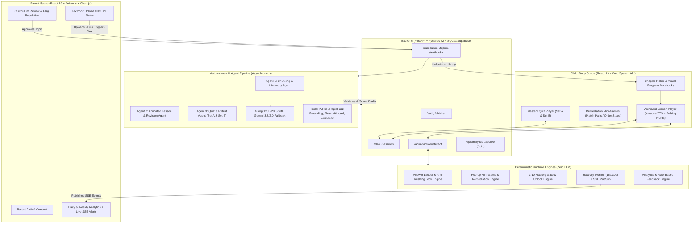
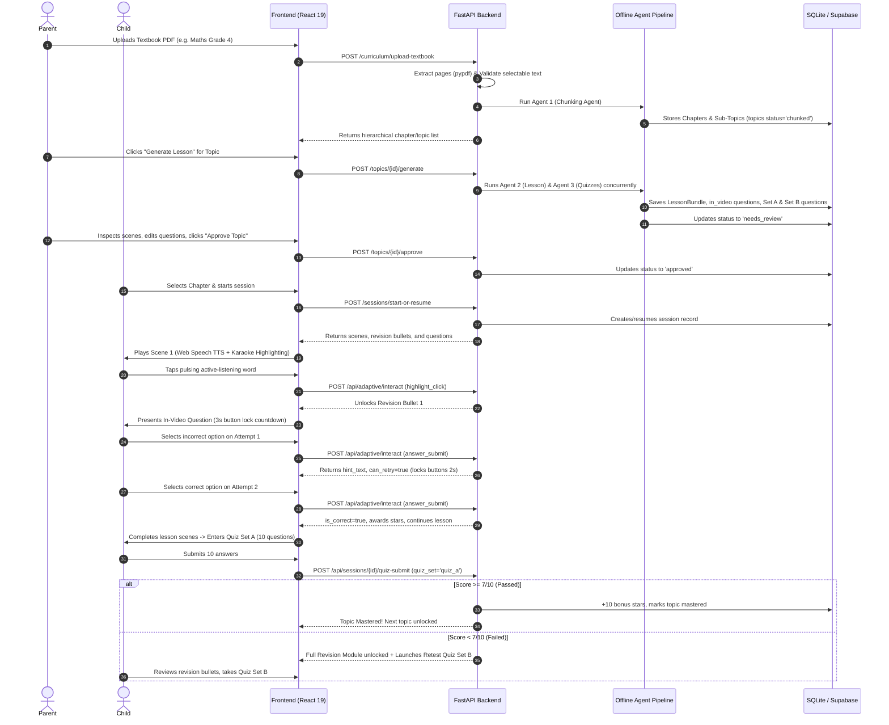

# DotLink: Deep-Dive Architectural & Functional Breakdown

**DotLink** is a full-stack, agentic educational web platform built for parents and children (Grades 1–12, primarily aligned with NCERT textbooks).

Its architecture is based on a core design principle:
1. **Offline / Asynchronous AI Agents**: When a parent uploads or selects a textbook chapter, multi-agent AI pipelines (powered by Groq or Google Gemini fallback) process, chunk, and generate rich interactive scenes, progressive revision sheets, and dual 10-question mastery quiz sets.
2. **100% Deterministic Real-Time Runtime**: Once content is generated and approved, **ZERO LLM calls occur during live student learning**. All anti-rushing locks, hint-to-explanation ladders, engagement mini-games, inactivity auto-pauses, mastery gate scoring, and parent analytics run on strict, predictable Python algorithms.

---

## 1. High-Level System Architecture



---

## 2. Technology Stack & Dependencies

| Layer | Technologies & Libraries | Key Responsibilities |
|---|---|---|
| **Frontend** | React 19, Vite 8, React Router v7, Vanilla CSS (Glassmorphism tokens, CSS variables, zero Tailwind) | Parent Portal, Child Play Mode, responsive layout, modal dialogs. |
| **Animation & Charts** | Anime.js v4, Chart.js, `react-chartjs-2`, `qrcode` | Page transitions, crab pull landing animation, chapter notebook 3D pop-ins, SVG donut charts, student QR login. |
| **Audio & Speech** | Web Speech API (`SpeechSynthesis`), HTML5 Web Audio API | Client-side narration with word-by-word karaoke highlighting and speed controls; audio effects. |
| **Backend Framework** | FastAPI (Python 3.11+ / 3.13), Uvicorn, Pydantic v2 | High-throughput asynchronous REST API, route handlers, schema validation. |
| **Database & ORM** | `aiosqlite` (local WAL mode), Supabase PostgreSQL (`supabase-py`) | Dual database architecture: seamless local offline SQLite development & Supabase cloud production. |
| **Auth & Security** | `python-jose` (JWT), `bcrypt` (password hashing) | Mandatory parent consent verification, parent JWT tokens, child profile isolation. |
| **Document Processing** | `pypdf`, `rapidfuzz` | PDF text extraction, selectable text validation, fuzzy token matching for grounding. |
| **LLM Orchestration** | Groq API (`openai/gpt-oss-120b`, `openai/gpt-oss-20b`), Google Gemini API (`gemini-3.8-flash` / `gemini-2.0-flash`) | Deep content generation with automatic exponential backoff, rate limit handling, and offline deterministic fallback. |
| **Live Communications** | Server-Sent Events (SSE) via `asyncio.Queue` Pub/Sub | Real-time push notifications from student sessions directly to parent dashboard. |

---

## 3. Database Architecture (12 Relational Entities)

The database schema (implemented identically in [sql/schema.sql](file:///c:/Documents/projects/dotlink/sql/schema.sql) and [app/db.py](file:///c:/Documents/projects/dotlink/app/db.py)) contains 12 core tables:

1. **`profiles`**: Parent identity (UUID, name, email, bcrypt password hash, `consent_given` boolean, timestamp).
2. **`children`**: Child learners tied to `parent_id` (name, age, grade, mascot name, `total_stars`).
3. **`textbooks`**: Master textbook metadata (grade, subject, title, `ncert_code`, `storage_path`, `page_count`).
4. **`topics`**: Hierarchical units representing chapters and sub-topics (`chapter_number`, `chapter_title`, `topic_number`, `start_page`, `end_page`, `status`, `version`). Status state machine: `chunked` $\to$ `generating` $\to$ `needs_review` $\to$ `approved`.
5. **`source_pages`**: Extracted text per page. Shielded strictly on the backend; never exposed to student-facing endpoints.
6. **`lesson_bundles`**: Generated educational content for a topic:
   - `scenes_json`: Visual scene descriptions, narration scripts, word-level variants (`standard`, `simplified`, `short`), interaction beats.
   - `revision_bullets_json`: Progressive bullet points unlocked sequentially.
   - `mini_game_config`: Paired concept items for engagement refreshers.
   - `status`: `draft` or `approved`.
7. **`questions`**: All multiple-choice questions belonging to a topic:
   - `question_type`: `in_video` (embedded in scenes), `quiz_a` (Mastery Evaluation), or `quiz_b` (Retest).
   - `question_data`: Question text, 3–4 options, difficulty (`easy`, `medium`, `application`).
   - `correct_answer`, `hint_text`, `explanation_text`, `source_page`, `flagged`, `flag_reason`.
8. **`agent_steps`**: Full audit trail of AI agent tool execution (`run_id`, `agent_name`, `step_num`, `tool_name`, `args_json`, `result_summary`).
9. **`sessions`**: Live learning sessions per child and topic (`last_scene_index`, `unlocked_bullets_count`, `active_focus_seconds`, `status`: `active`, `paused`, `completed`).
10. **`attempts`**: Question attempt telemetry (`attempt_number`, `is_correct`, `time_taken`, `hint_shown`, `explanation_shown`, `pop_up_game_triggered`, `stars_earned`, `silent_accuracy`).
11. **`quiz_submissions`**: Set A and Set B 10-question evaluation submissions (`quiz_set`, `score_out_of_10`, `passed`).
12. **`idle_events`**: Inactivity prompts logged when a student stops responding (`prompted_at`, `responded`, `auto_paused_at`).

---

## 4. In-Depth Features & Agent Workflows

### Feature 1: Parent Portal, Authentication & Consent
- **Location**: [app/routers/auth.py](file:///c:/Documents/projects/dotlink/app/routers/auth.py), [frontend/src/pages/parent/Login.jsx](file:///c:/Documents/projects/dotlink/frontend/src/pages/parent/Login.jsx).
- **Mandatory Consent**: Parents cannot register without explicitly consenting to COPPA/data policies. If `consent_given` is false, signup fails immediately.
- **Auto-Learner Provisioning**: On registration, a default child learner profile is automatically created (e.g. "Learner", Grade 4, mascot "Luna the Owl") so parents can explore immediately without complex onboarding.
- **Parent Hub**: [ParentHub.jsx](file:///c:/Documents/projects/dotlink/frontend/src/pages/parent/ParentHub.jsx) provides a clean entry point with quick access to the curriculum manager, analytics, and Kids Space entry via a scannable QR code.

### Feature 2: PDF Ingestion & Intelligent Chunking (Agent 1)
- **Location**: [app/services/pdf_ncert.py](file:///c:/Documents/projects/dotlink/app/services/pdf_ncert.py), [app/agents/chunking_agent.py](file:///c:/Documents/projects/dotlink/app/agents/chunking_agent.py).
- **Selectable Text Validation**: Validates that uploaded PDFs contain real text (minimum 50 characters) and rejects scanned image PDFs with a descriptive error.
- **Storage Dual-Write**: Saves PDFs to the local filesystem (`local_storage/<parent_id>/`) and uploads them to the private Supabase Storage bucket (`textbooks`) if Supabase credentials are configured.
- **Macro Structure Analysis**:
  - Automatically identifies and filters out Table of Contents pages, running headers/footers, and page numbers.
  - **Boundary Protection**: Detects worked problems (`Example`, `Activity`, `Try This`) and ensures they are never split across topic boundaries.
- **Chunking Policy**:
  - Small chapters ($\le 6$ pages or $\le 2500$ words) remain a single cohesive topic.
  - Long chapters are partitioned using dynamic programming (`_partition_blocks`) into child-friendly units of 800–1800 words (target $\approx 1200$ words).
  - Stores exact source pages, word counts, and page fragments in `agent_steps.args_json` under `topic_source` to prevent adjacent topics on shared pages from cross-contaminating source text.

### Feature 3: Asynchronous Lesson & Quiz Generation (Agents 2 & 3)
- **Location**: [app/agents/lesson_revision_agent.py](file:///c:/Documents/projects/dotlink/app/agents/lesson_revision_agent.py), [app/agents/quiz_agent.py](file:///c:/Documents/projects/dotlink/app/agents/quiz_agent.py), [app/routers/curriculum.py](file:///c:/Documents/projects/dotlink/app/routers/curriculum.py).
- **Concurrent Agent Execution**: When generation is triggered, FastAPI runs Agent 2 and Agent 3 concurrently using `asyncio.gather` under an `asyncio.Semaphore` limit (`GENERATION_CONCURRENCY = 2`) to avoid exhausting system memory or API rate limits.
- **Agent 2 (Lesson & Revision Agent)**:
  - Generates 4 to 8 interactive scenes (approx. 1 scene per 150–250 source words).
  - Each scene has a visual description, interaction beat, standard narration, and simplified/short narration variants.
  - Generates highlighted active-listening words tied to specific scenes.
  - Generates in-video checkpoint questions.
  - Produces sequential bullet-point revision sheets.
  - Assembles a 6–8 pair matching mini-game configuration.
  - Validates grade readability using the deterministic **Flesch-Kincaid formula** (`tools.check_reading_level`).
- **Agent 3 (Quiz & Retest Agent)**:
  - Generates exactly two non-overlapping 10-question multiple-choice quizzes: **Set A** (Mastery evaluation) and **Set B** (Retest).
  - Enforces difficulty progression: Question 1 is easy, Questions 2–9 are medium, and Question 10 is real-world application.
  - Verifies math and arithmetic using an exact calculator tool.
  - Verifies factual grounding against source pages using **RapidFuzz token set ratio** (threshold $\ge 65\%$).
- **Deterministic Python Backstop & Retry Loop**:
  - If question validation fails, the agent tool-calling loop automatically returns validation errors to the LLM for up to 2 retries.
  - Cross-checks question stems between in-video questions and quiz questions. Any duplicate question is automatically flagged for parent review (`flagged = 1, flag_reason = 'Duplicate of a lesson question'`).
  - If third-party API keys are missing or offline, fallback generator functions (`build_deterministic_lesson`, `build_deterministic_quizzes`) generate valid educational content so the entire platform runs completely offline.

### Feature 4: Parent Review & Content Approval Gate
- **Location**: [app/routers/curriculum.py](file:///c:/Documents/projects/dotlink/app/routers/curriculum.py), [frontend/src/pages/parent/CurriculumReview.jsx](file:///c:/Documents/projects/dotlink/frontend/src/pages/parent/CurriculumReview.jsx).
- **Full Review Dashboard**: Parents can inspect all scenes, revision bullets, in-video questions, Quiz Set A, Quiz Set B, and view the original textbook source page text in an overlay popover.
- **In-Place Question Editing**: Parents can edit question text, options, correct answers, hints, explanations, and linked source page numbers. Saving an edit automatically clears the flagged status.
- **Strict Approval Criteria**: Approval requires exactly 10 questions in Set A and 10 questions in Set B. Once approved, the topic becomes visible in the child's study space.
- **Draft Versioning & Isolation**:
  - If an already approved topic is regenerated, DotLink chunks the chapter into a new version and generates replacement draft topics (`version = 2`).
  - Children continue seeing and playing the currently approved version without disruption.
  - The replacement chapter only replaces the live version when **all** topics in the replacement chapter have been reviewed and approved by the parent.

---

### Feature 5: Child Study Space & Interactive Lesson Player
- **Location**: [frontend/src/pages/child/AnimatedLessonPlayer.jsx](file:///c:/Documents/projects/dotlink/frontend/src/pages/child/AnimatedLessonPlayer.jsx), [frontend/src/pages/child/AnimatedStage.jsx](file:///c:/Documents/projects/dotlink/frontend/src/pages/child/AnimatedStage.jsx).
- **Chapter Picker**: Visual bookshelf displaying notebook cards, percentage completion timeline, and total focus minutes.
- **Interactive Animated Stage**:
  - Displays dynamic SVG and CSS animations representing the lesson concept (e.g., shapes, bricks, nature, math).
  - Uses the browser's native **Web Speech API** (`speechSynthesis`) for synchronized audio narration with adjustable playback rate (0.95x).
  - Implements word-by-word **karaoke highlighting**, dynamically tracking speech boundaries.
- **Active-Listening Highlighted Words**:
  - Key vocabulary and concepts pulse on the screen during narration.
  - When the child clicks a highlighted word, an adaptive call unlocks the next bullet point in the revision sheet drawer, reinforcing attentive listening.
- **Anti-Rushing Button Locks**:
  - When a question appears, all answer buttons are locked for **3 seconds** (`LOCK_SECONDS_QUESTION`) with a visual countdown timer to force the child to read the prompt.
  - On retry after an incorrect answer, buttons are locked for **2 seconds** (`LOCK_SECONDS_RETRY`).
- **Answer Ladder Logic (100% Deterministic)**:
  - **First attempt correct**: Awards **+3 stars**, marks silent accuracy, and continues lesson.
  - **First attempt incorrect**: Displays pedagogical `hint_text`, triggers a 2-second lock, and allows a second attempt.
  - **Second attempt incorrect**: Displays comprehensive `explanation_text`, awards **+1 participation star**, and advances the lesson.

---

### Feature 6: Inactivity Monitoring & Live Parent SSE Alerts
- **Location**: [app/services/idle_monitor.py](file:///c:/Documents/projects/dotlink/app/services/idle_monitor.py), [frontend/src/components/StudentInactivity.jsx](file:///c:/Documents/projects/dotlink/frontend/src/components/StudentInactivity.jsx).
- **Student Inactivity Check**:
  - If 15 seconds elapse without student interaction during lessons or quizzes, an *"Are you still watching?"* dialog pops up with a 30-second countdown.
  - If the child clicks *"I'm here!"*, the session resumes normally.
  - If the 30-second countdown expires without a response, the backend sets the session status to `paused` and pauses all internal response clocks.
- **Active Focus Heartbeat**:
  - While active, the frontend sends a heartbeat ping every 10 seconds (`/api/sessions/{id}/heartbeat`) to record verified learning minutes (`active_focus_seconds`). Heartbeats stop when paused or in inactivity mode.
- **Real-Time Parent Alerts via SSE**:
  - An in-process `asyncio.Queue` Pub/Sub manager streams live updates to the parent dashboard (`/api/live/{child_id}`).
  - Pushes real-time events: `session_started`, `session_paused`, `idle_alert`, `session_completed`, with periodic SSE comment heartbeats (`: heartbeat`) every 15 seconds to prevent network dropouts.
  - When an inactivity auto-pause occurs, the parent instantly receives a notification banner with the child's name, topic, and timestamp.

---

### Feature 7: Adaptive Engagement & Remediation Mini-Games
- **Location**: [app/services/adaptive_engine.py](file:///c:/Documents/projects/dotlink/app/services/adaptive_engine.py), [app/services/remediation.py](file:///c:/Documents/projects/dotlink/app/services/remediation.py), [frontend/src/remediation/](file:///c:/Documents/projects/dotlink/frontend/src/remediation/).
- **Trigger Conditions**:
  - **Dragging Engagement**: If the child's response time is significantly slower than expected ($\text{time\_taken} / \text{expected\_time} > 1.5$, where $\text{expected\_time} = 4.0\text{s} + 0.35\text{s} \times \text{word\_count}$).
  - **Rapid Guessing**: Two consecutive incorrect answers submitted within 1.5 seconds post-lock.
  - **Two-Miss Remediation**: Second incorrect attempt on a question triggers pedagogical assistance.
  - Includes a 5-minute cooldown (`MINI_GAME_COOLDOWN_SECONDS = 300`) between spontaneous mini-games to avoid disruption.
- **Embedded Mini-Games**:
  1. **Match Pairs**: Interactive 6–8 card tile-matching game linking concepts, terms, and values.
  2. **Order Steps**: Tactile card drag-and-drop or tap-to-place ordering game guided by mascot Luna, breaking arithmetic or reading problems into 3 sequential steps.
- **Ungraded Practice Resume**:
  - During mini-games, response clocks and quiz scoring are paused.
  - Once completed, the original question returns as an **ungraded practice attempt**, followed by its explanation and a continue button, restoring confidence before moving forward.

---

### Feature 8: The 7/10 Mastery Gate & Retest Protocol
- **Location**: [app/services/mastery_gate.py](file:///c:/Documents/projects/dotlink/app/services/mastery_gate.py), [app/routers/play.py](file:///c:/Documents/projects/dotlink/app/routers/play.py), [frontend/src/pages/child/QuizView.jsx](file:///c:/Documents/projects/dotlink/frontend/src/pages/child/QuizView.jsx).
- **Set A Scoring**:
  - The 10 questions in Quiz Set A are graded strictly on **first-attempt accuracy**.
- **Path 1: Mastery Pass ($\text{Score} \ge 7/10$)**:
  - Awards **+10 bonus stars**.
  - Marks topic as mastered.
  - Automatically unlocks the next sequential topic in the textbook.
  - Surfaces corrections for any missed questions.
- **Path 2: Mastery Fail ($\text{Score} < 7/10$)**:
  - **No bonus stars** awarded; next topic remains locked.
  - Unlocks the **Full Revision Module**: displays all bullet points from the lesson bundle alongside a breakdown of missed questions with explanations and source page references.
  - Automatically arms **Retest Quiz Set B** (10 parallel, non-overlapping questions testing identical concepts).
- **Retest Set B Outcome**:
  - If Set B score $\ge 7/10$: Student passes, awards mastery bonus stars, and unlocks the next topic.
  - If Set B score $< 7/10$: Surfaces detailed corrections; topic remains unmastered for future review.

---

### Feature 9: Parent Analytics & Deterministic Feedback Cards
- **Location**: [app/services/analytics_engine.py](file:///c:/Documents/projects/dotlink/app/services/analytics_engine.py), [app/services/insights_rules.py](file:///c:/Documents/projects/dotlink/app/services/insights_rules.py), [frontend/src/pages/parent/DailySnapshot.jsx](file:///c:/Documents/projects/dotlink/frontend/src/pages/parent/DailySnapshot.jsx).
- **Four Core Analytics Metrics** computed across the last 7 days:
  1. **Accuracy**: First-attempt silent accuracy vs. final accuracy; Set A vs. Set B scores.
  2. **Attention Span**: Average continuous focused minutes before an idle pause or mini-game trigger.
  3. **Time Focused**: Total verified active minutes calculated from 10-second heartbeats.
  4. **Speed of Response**: Average seconds taken to answer post-lock across all questions.
- **Deterministic Feedback Card (Zero LLM)**:
  - Generates clear parent summaries without AI hallucination risk:
    - Topics mastered this week.
    - Topics needing revision (failed gate without retest pass, or accuracy $< 60\%$).
    - Recommended next topic based on textbook progression.

---

## 5. Step-by-Step System Working Flows

### End-to-End Learning Lifecycle



---

## 6. Project Directory Map

```
dotlink/
├── app/                                 # FastAPI Backend Application
│   ├── main.py                          # Application entry point, CORS, router inclusion, lifespan
│   ├── config.py                        # Centralized configuration (locks, timers, model names)
│   ├── db.py                            # SQLite/Supabase initialization and 12-table DDL schema
│   ├── deps.py                          # JWT token encoding/decoding, bcrypt auth, ownership dependencies
│   ├── validators.py                    # Input validation utilities
│   ├── models/
│   │   └── schemas.py                   # Pydantic v2 data models for API requests, responses, and agent tools
│   ├── routers/
│   │   ├── auth.py                      # Parent signup, login, JWT token issuance
│   │   ├── children.py                  # Child profile creation and listing
│   │   ├── curriculum.py                # PDF upload, chunking, background generation, approval, review edits
│   │   ├── play.py                      # Play topics listing, session start/resume, scene updates, quiz submit
│   │   ├── adaptive.py                  # Live interaction endpoint (word clicks, question attempts, locks)
│   │   └── dashboard.py                 # Analytics computation, idle logging, heartbeat, and live SSE stream
│   ├── agents/
│   │   ├── loop.py                      # Shared autonomous tool-calling loop with Pydantic validation
│   │   ├── tools.py                     # Reading level (Flesch-Kincaid), RapidFuzz grounding, calculator
│   │   ├── topic_source.py              # Exact topic text and fragment extraction from source_pages
│   │   ├── source_content.py            # Deterministic fallback scene and question generators
│   │   ├── validators.py                # Schema validators and Python code backstop
│   │   ├── ncert_agent.py               # Agent 1 legacy NCERT catalog fetcher and chunker
│   │   ├── chunking_agent.py            # Agent 1 modern digital PDF hierarchy and chunking agent
│   │   ├── lesson_revision_agent.py     # Agent 2 animated lesson, active words, and revision sheet agent
│   │   └── quiz_agent.py                # Agent 3 dual 10-question mastery quiz (Set A / Set B) agent
│   └── services/
│       ├── llm.py                       # Groq API caller with exponential backoff and Gemini fallback
│       ├── pdf_ncert.py                 # PDF byte reader, selectable text check, Supabase/local storage
│       ├── adaptive_engine.py           # Button lock timers, answer ladder, low-engagement evaluator
│       ├── mastery_gate.py              # Pure deterministic 7/10 mastery evaluator
│       ├── idle_monitor.py              # Inactivity tracking, session auto-pause, in-process SSE PubSub
│       ├── analytics_engine.py          # Daily/weekly Chart.js series (accuracy, attention, time, speed)
│       ├── insights_rules.py            # Rule-based feedback card generator
│       └── remediation.py               # Remediation game configuration builder
├── frontend/                            # React 19 + Vite 8 SPA
│   ├── src/
│   │   ├── main.jsx                     # React entry point
│   │   ├── App.jsx                      # React Router v7 routes & ProtectedRoute wrappers
│   │   ├── App.css / index.css          # Design system tokens, glassmorphism styling, reset styles
│   │   ├── api.js                       # Centralized fetch client handling JWT, error formatting, endpoints
│   │   ├── components/
│   │   │   ├── Navbar.jsx               # Navigation bar with user info and logout
│   │   │   └── StudentInactivity.jsx    # "Are you still watching?" 15s/30s idle countdown modal
│   │   ├── pages/
│   │   │   ├── Landing.jsx              # Landing page with interactive animated crab pull sequence
│   │   │   ├── parent/
│   │   │   │   ├── Login.jsx            # Parent login and signup with mandatory consent checkbox
│   │   │   │   ├── ParentHub.jsx        # Parent landing hub with navigation shortcuts and feedback
│   │   │   │   ├── Curriculum.jsx       # Textbook upload dropzone, anime.js animations, topic listing
│   │   │   │   ├── CurriculumReview.jsx # Lesson bundle editor, question reviewer, approval trigger
│   │   │   │   ├── DailySnapshot.jsx    # Daily learner metrics with animated SVG donut and line charts
│   │   │   │   ├── WeeklyStudentDashboard.jsx # 7-day analytics overview
│   │   │   │   └── KidsSpaceEntry.jsx   # Scannable QR code generator for student tablet login
│   │   │   ├── child/
│   │   │   │   ├── ChapterPicker.jsx    # 3D notebook chapter cards with progress bars
│   │   │   │   ├── StudentDashboard.jsx # Legacy student topic view
│   │   │   │   ├── AnimatedLessonPlayer.jsx # Interactive lesson player with Web Speech TTS, karaoke, drawer
│   │   │   │   ├── AnimatedStage.jsx    # Scene rendering stage with dynamic CSS/SVG animations
│   │   │   │   ├── RevisionSheet.jsx    # Slide-out drawer displaying unlocked revision bullets
│   │   │   │   └── QuizView.jsx         # 10-question mastery quiz player with timer and remediation
│   │   │   └── dev/
│   │   │       └── RemediationDev.jsx   # Developer harness for previewing mini-games in isolation
│   │   ├── remediation/                 # Self-contained remediation subsystem
│   │   │   ├── RemediationGame.jsx      # Modal game host with focus trapping
│   │   │   ├── MatchPairsGame.jsx       # Card pairing mini-game
│   │   │   ├── OrderStepsGame.jsx       # 3-step sequence ordering mini-game
│   │   │   ├── Companion.jsx            # Mascot avatar component (Luna the Owl)
│   │   │   └── useRemediationFlow.jsx   # State machine hook controlling remediation transitions
│   │   └── utils/
│   │       └── soundEffects.js          # Web Audio synthesizer for chimes, ticks, and feedback sounds
├── sql/
│   ├── schema.sql                       # Complete PostgreSQL schema for Supabase
│   └── seed_demo.sql                    # 2-week realistic child history seed data for Chart.js
├── tests/                               # Comprehensive pytest backend test suite (65 tests)
├── render.yaml                          # Render web service and static site deployment specification
└── requirements.txt                     # Pinned Python package dependencies
```

---

## 7. Current Test Suite Status

Both test suites are passing:
- **Backend Test Suite**:
  - Command: `python -m pytest`
  - Results: **65 passed in 7.78 seconds** ([tests/](file:///c:/Documents/projects/dotlink/tests/))
  - Modules covered: `test_adaptive_engine.py`, `test_agent_validators.py`, `test_chunking_policy.py`, `test_llm_generation_transport.py`, `test_mastery_gate.py`, `test_requested_changes.py`, `test_upload_and_chunking.py`, `test_v01_pipeline.py`, `test_v02_lesson_player.py`, `test_v04_mastery_pipeline.py`, `test_v05_idle_and_parent.py`.
- **Frontend Test Suite**:
  - Command: `npm --prefix frontend test`
  - Results: **36 passed across 7 test suites** ([frontend/src/](file:///c:/Documents/projects/dotlink/frontend/src/))
  - Modules covered: `matchPairsReducer.test.js`, `api.test.js`, `orderStepsReducer.test.js`, `remediation.test.jsx`, `StudentDashboard.test.jsx`, `Curriculum.test.jsx`, `flow.test.jsx`.

---

## 8. Deployment Setup & Crucial Considerations for Future Changes

Because you mentioned having already deployed the project and needing to make significant modifications, keep the following technical considerations in mind:

### 1. In-Process Server-Sent Events (SSE) Architecture
- **Current Behavior**: The live parent stream (`/api/live/{child_id}`) in [app/services/idle_monitor.py](file:///c:/Documents/projects/dotlink/app/services/idle_monitor.py) uses Python `asyncio.Queue` objects stored in server memory (`_listeners: Dict[str, Set[asyncio.Queue]]`).
- **Deployment Caveat**: This works on a single Render instance. If you scale the backend beyond 1 instance or deploy on serverless platforms (AWS Lambda, Vercel Functions), the student's instance and the parent's SSE connection will hit different processes, breaking live alerts.
- **Recommended Change**: Introduce a Redis / Upstash Redis Pub/Sub backend for multi-instance deployments.

### 2. Dual Database Engine (SQLite vs. Supabase PostgreSQL)
- **Current Behavior**: Locally, the application connects to `dotlink.db` using `aiosqlite`. On Render/Supabase, it can point to Supabase Postgres.
- **Deployment Caveat**: Notice that SQLite stores timestamps as `TEXT` (via `datetime('now')`), whereas PostgreSQL uses `TIMESTAMPTZ`. Similarly, JSON columns in SQLite are `TEXT`, while Postgres uses native `JSONB`.
- **Recommended Change**: If moving to a persistent production PostgreSQL instance, ensure migrations and query filters (such as `date(created_at)`) maintain cross-engine compatibility or standardize entirely on async SQLAlchemy or SQLModel.

### 3. LLM API Rate Limits & Timeouts
- **Current Behavior**: Heavy generation uses Groq's `openai/gpt-oss-120b` with a fast-fail threshold (2.5s) before falling back to Google Gemini (`gemini-3.8-flash` / `gemini-2.0-flash`).
- **Deployment Caveat**: During long chapter generation, if Groq encounters an HTTP 429 and Gemini hits daily quota caps, generation fails and reverts topic status.
- **Recommended Change**: Keep the fallback generator active and consider adding request caching or queuing with Celery/RQ for high-concurrency production usage.

### 4. Client-Side Speech Synthesis
- **Current Behavior**: The Animated Lesson Player relies on the browser's native `window.speechSynthesis`.
- **Deployment Caveat**: Different operating systems (macOS, Windows, Android, iOS Safari) provide vastly different voice quality, and some mobile browsers mute speech unless triggered by an explicit user gesture.
- **Recommended Change**: If uniform, natural child-friendly voice quality is required across all devices, integrate an API-based TTS service (such as ElevenLabs or Google Cloud Text-to-Speech) to generate cached MP3 audio files during lesson generation.

---

### Suggested Next Steps

Whenever you are ready to make changes, tell me which area you would like to tackle first:
1. **Curriculum & Agent Pipeline** (e.g., custom prompts, extra subjects, improved PDF chunking).
2. **Student Learning UX & Narration** (e.g., enhanced scene graphics, ElevenLabs audio narration, new mini-games).
3. **Parent Analytics & Live Monitoring** (e.g., Redis Pub/Sub for SSE, additional learning metrics, PDF report downloads).
4. **Production Infrastructure & Database Migration** (e.g., Postgres migration, Docker containerization, auth enhancements).
