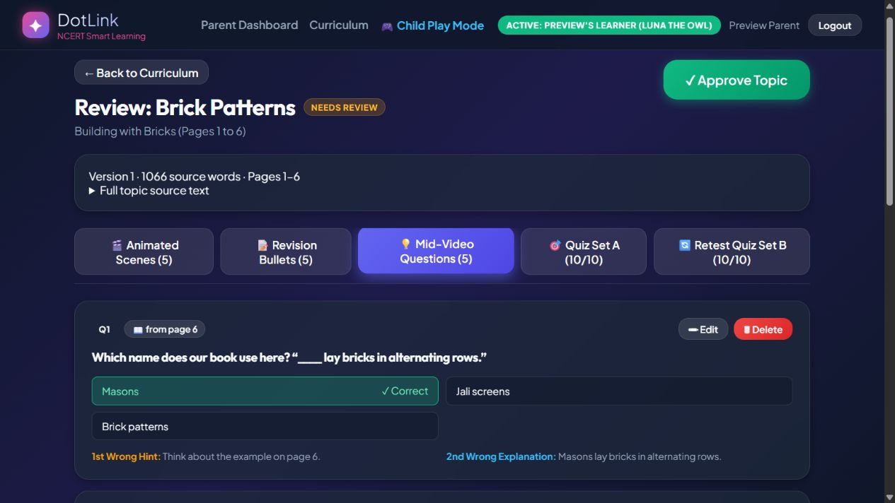
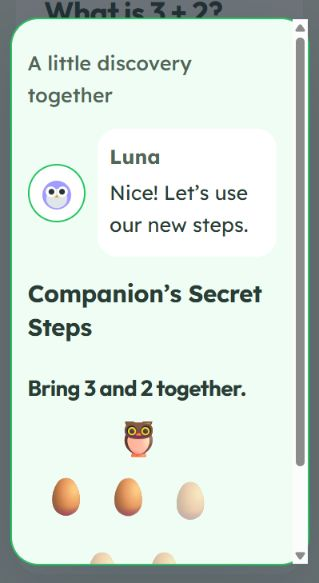
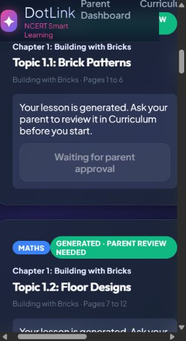
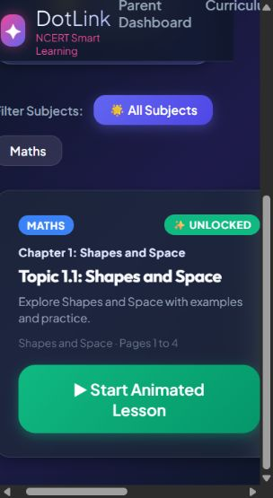

# Parts A–C verification

Verified on 24 October 2026 with fake models and a separate preview database. No live model latency benchmark was performed.

## Requested instruction files

`AGENTS.md` and `docs/PIPELINE.md` were not present in this checkout. No instructions from those files could be read.

## Agent runs

### Shapes and Space (4 pages)

Trace: **Chapter is short, kept as one topic**

| Topic | Pages | Source words | Lesson questions | Scenes | Flagged questions |
|---|---:|---:|---:|---:|---:|
| Shapes and Space | 1–4 | 357 | 4 | 4 | 0 |

Each topic also retains the existing ten-question Set A and ten-question Set B mastery quizzes. The 4–8 scaling applies to topic lesson questions, preserving the existing mastery scoring and approval requirements.

### Building with Bricks (30 pages)

Trace: **Chapter is long, split into 5 topics**

| Topic | Pages | Source words | Lesson questions | Scenes | Flagged questions |
|---|---:|---:|---:|---:|---:|
| Brick Patterns | 1–6 | 1066 | 5 | 5 | 0 |
| Floor Designs | 7–12 | 1103 | 6 | 6 | 0 |
| Building Arches | 13–18 | 1145 | 6 | 6 | 0 |
| Measuring Walls | 19–24 | 1145 | 6 | 6 | 0 |
| Estimating Materials | 25–30 | 1103 | 6 | 6 | 0 |

Each topic also retains the existing ten-question Set A and ten-question Set B mastery quizzes. The 4–8 scaling applies to topic lesson questions, preserving the existing mastery scoring and approval requirements.

## Approved content and source preservation

No database schema or columns were added. Exact topic text, word counts and page fragments are stored in the existing `agent_steps.args_json` JSON, under `topic_source`. This prevents adjacent topics sharing a page from consuming each other’s source.

Re-running generation on an approved topic re-chunks its chapter into a new version and generates the replacement topics as drafts needing the existing parent approval. Approved topics, lesson bundles, questions, sessions and source-page links are retained. Children continue to see the previous fully approved chapter until every topic in the replacement chapter has been approved. Existing sessions retain their original topic IDs.

The existing approval endpoint, auth files, reward values, answer-ladder calculations and mastery scoring files were not edited. No data migration runs on startup.

## Runtime behavior

- A shared 15-second inactivity dialog pauses the response clock in lessons and quizzes.
- Chapter cards are grouped by textbook plus chapter number, labelled with chapter names, and use recorded study progress and focus minutes. No placeholder books or invented progress remain.
- The third report graph is removed from the shared daily/weekly report and the legacy report metric selector.
- The answer API uses persisted attempts and serializes its second-miss decision. It returns `breakdown`, `remediation`, and the correct option ID once per question. The existing answer ladder supplies the hint and explanation.
- During the game and three-second reveal, the underlying quiz is inert and its clocks are paused. The same question returns for ungraded practice, followed by its original explanation and an explicit Continue action.
- Both games support keyboard input; step ordering also supports touch/mouse pointer dragging and tap-to-place. Modal focus is trapped and restored, including during the reveal.
- Games automatically assist and complete before thirty seconds, use calm feedback, respect reduced motion and sound preferences, and send optional telemetry silently with question ID and quiz set.
- `/dev/remediation` includes the requested controls and full three-question Set A/Set B mock flow. Simulate stalling accelerates assistance only in the dev preview.

## Performance changes

PDF extraction runs off the async server thread, page inserts are batched, and heading-based chunking avoids a redundant model call. Lesson and mastery model calls overlap; generation concurrency is bounded. Models receive the complete exact topic text rather than a truncated 3,500-character excerpt.

## Validation

- Backend: `venv/Scripts/python.exe -m pytest -q` — 62 passed.
- Frontend: `npm test -- --pool=threads --maxWorkers=1 --reporter=dot` — 27 passed.
- Frontend linter: `npm run lint` — exits successfully with warnings.
- Production build: `npm run build` — passes; Vite reports a bundle-size warning.
- Python compilation: `python -m compileall -q app scripts` — passes.
- Tests use a temporary SQLite database and offline/fake model settings; no production model credits are used.

Regression coverage includes short and long chapters, oversized heading parts, worked-example boundaries, source evidence/ranges, arithmetic-equivalent answers, real two-retry failures, draft-version isolation, server-controlled remediation for lesson/Set A/Set B, keyboard focus, pointer input, inactivity timing and the complete game/reveal/practice/explanation flow.

## Browser verification

Opened the actual parent review screen for the small chapter and a large-chapter topic. Confirmed full source text, scene/question counts, Set A/Set B tabs and correct-answer markings. No preview content was approved. Played the remediation popup over the mock quiz and confirmed the same question and explanation appeared afterwards.

## Reproduce the samples

Follow-up on the real saved lesson: the newest `Big Numbers` lesson is generated but `needs_review`; the account-specific route returned zero approved topics and this lesson in `pending_lessons`. Generated initial-version lessons now have visible, disabled review-status cards, with a five-second refresh and refresh on window focus. Unapproved replacement chapters remain hidden while their approved version is live, and session creation still rejects pending lessons. The running frontend on port 5175 has been reconnected from the isolated API on port 8001 to the normal API on port 8000; the preview server was stopped and its test account signed out of the browser.

The real provider rejected full Pydantic tool schemas sent as its restricted `parameters` type. Gemini now receives `parametersJsonSchema`, following the [official function-declaration reference](https://ai.google.dev/api/generate-content#FunctionDeclaration), and API credentials are sent in a header rather than the request URL. The configured model is available, but a follow-up live probe returned HTTP 429 for the exhausted daily generation quota. No further model calls were made. Request timeout is configurable so a valid long response is not cut off after eight seconds. No real content was approved or regenerated. Tests: 65 backend and 36 frontend pass; build and linter complete with warnings. A live successful regeneration remains unverified until the provider quota is available.

Kids-page regression checked: an approved topic in the original chapter version remains visible while neighbouring topics are chunked or awaiting review. Replacement chapters still require full approval before replacing the live version. Read-only verification on Shivu's saved data returned zero visible lessons with the previous filter and one with the corrected filter. All child lesson requests now use the configured API, including loading, scene progress and pause. The isolated browser sample was approved through the existing review screen, appeared in Child Play Mode, opened its animated scenes and paused back to the lesson list. No real parent content was approved or modified. Current checks: 63 backend tests, 35 frontend tests; build and linter pass with warnings.

Upload regression checked: fixed `/textbooks` reading a nonexistent textbook `version` column. A browser upload of a four-page test PDF displayed the uploaded book, chapter and topic. The UI keeps the upload response visible if a refresh fails and offers a loading retry. Upload/reopen and refresh-failure frontend tests pass. Current checks: 62 backend tests, 29 frontend tests; build and linter pass with warnings. No database schema or approval changes were needed.

Run `venv/Scripts/python.exe scripts/verify_requested_changes.py` to generate isolated samples and `venv/Scripts/python.exe scripts/verify_requested_changes.py --serve` to serve the separate preview API on port 8001. The local preview account is created only in that database; credentials are in the verification script. Its database and source output are under ignored `local_storage/verification/`.
